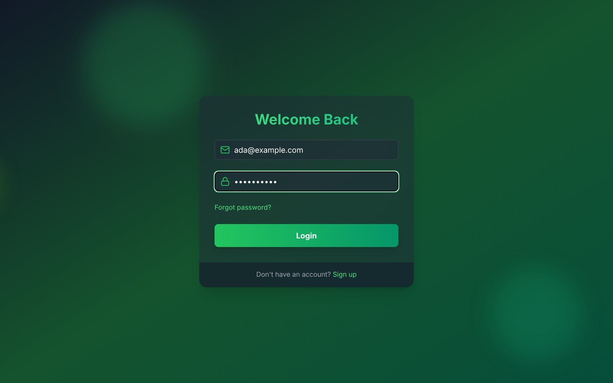
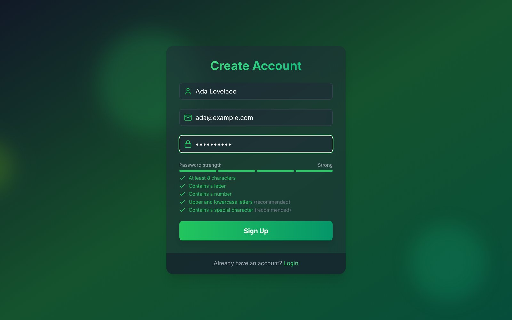

# 🔐 Advanced MERN Authentication System


A full-stack authentication system written end-to-end in **TypeScript** (MongoDB, Express, React, Node.js): sign-up with email verification, login, protected routes and email-based password reset — with input validation, rate limiting and an integration test suite.

**🔗 Live demo:** [auth-project-tdty.onrender.com](https://auth-project-tdty.onrender.com)

> The demo runs on a free Render instance — the first request after inactivity can take ~30–50 seconds while the server wakes up. Verification codes and reset links are sent to the email you sign up with (check your spam folder).

## 📸 Screenshots

| Login | Sign up |
|---|---|
|  |  |

## 📌 Features

- Sign up and log in with email + password
- **Email verification** with a 6-digit code (24 h expiry, max 5 attempts, resend with cooldown)
- **Forgot / reset password** with a one-time link (1 h expiry)
- Welcome and password-changed confirmation emails
- Session via **JWT in an `httpOnly`, `SameSite=Strict` cookie** (7 days)
- Protected / guest-only routes on the client, live password strength meter
- Animated, responsive UI (Tailwind CSS + Framer Motion)

## 🛡️ Security

| Concern | How it's handled |
|---|---|
| Passwords | bcrypt (12 rounds), hashed in a Mongoose pre-save hook; 8–72 chars, letter + number |
| Stored tokens | Verification codes and reset tokens are stored as **SHA-256 hashes**, never in plain text |
| Data exposure | Secret fields are `select: false` in the schema; responses go through an explicit allow-list (`toPublicUser`) |
| Input | Every request body/param is validated and normalised with **zod** (e.g. emails trimmed + lower-cased) |
| Brute force | `express-rate-limit` on auth routes (stricter on email-sending ones); verification code locks after 5 wrong tries |
| User enumeration | Login returns the same error and takes the same time for unknown emails; forgot-password always returns the same message |
| Headers | `helmet` (CSP, HSTS, no `x-powered-by`), 10 kB JSON body limit |
| Config | Environment variables validated at startup — the server refuses to start with a missing or weak `JWT_SECRET` |

## 🛠 Tech Stack

| Layer | Technologies |
|---|---|
| Frontend | React 18, TypeScript, Vite, React Router, Zustand, Axios, Tailwind CSS, Framer Motion |
| Backend | Node.js, Express, TypeScript, Mongoose, zod, JWT, bcryptjs, helmet, express-rate-limit |
| Database | MongoDB Atlas |
| Email | Brevo transactional email (HTTP API) |
| Testing | Vitest, Supertest (integration tests against a real MongoDB) |
| CI / Hosting | GitHub Actions, Render |

## 🔄 Auth Flow

1. **Sign up** → user saved, auth cookie set, 6-digit code emailed
2. **Verify email** (requires the cookie) → account marked verified → welcome email
3. **Log in** → credentials checked, auth cookie set
4. **Forgot password** → one-time reset link emailed → **Reset password** → confirmation email
5. **Check auth** on every page load (`GET /api/auth/check-auth`)

## 📡 API

All responses are JSON: `{ success, message?, user? }`. Validation errors return `400` with per-field `errors`.

| Method | Endpoint | Auth | Description |
|---|---|---|---|
| POST | `/api/auth/signup` | – | Create account, send verification code |
| POST | `/api/auth/verify-email` | cookie | Verify with the 6-digit code |
| POST | `/api/auth/resend-verification` | cookie | Send a new code |
| POST | `/api/auth/login` | – | Log in |
| POST | `/api/auth/logout` | – | Log out (clears cookie) |
| POST | `/api/auth/forgot-password` | – | Send password reset link |
| POST | `/api/auth/reset-password/:token` | – | Set a new password |
| GET | `/api/auth/check-auth` | cookie | Current user |
| GET | `/api/health` | – | Health check |

## 🚀 Getting Started

Requires **Node.js 22.12+** (see `.nvmrc`) and a MongoDB database (local or Atlas).

```bash
git clone https://github.com/BurakCelebi-front/Auth-Project.git
cd Auth-Project
npm install
npm install --prefix frontend
cp .env.example .env      # then fill in MONGO_URI and JWT_SECRET
```

Run the API and the React app in two terminals:

```bash
npm run dev           # API on http://localhost:5174 (auto-restarts on change)
npm run dev:client    # React app on http://localhost:5173 (proxies /api to the API)
```

> Without Brevo credentials in development, emails (verification codes, reset links) are printed to the API terminal, so the whole flow works locally with no email provider.

### Scripts

| Command | What it does |
|---|---|
| `npm run dev` / `npm run dev:client` | Start API / React app in watch mode |
| `npm run typecheck` | Type-check backend and frontend (strict mode) |
| `npm run lint` | ESLint (`typescript-eslint` strict, type-aware) |
| `npm test` | Run unit + integration tests (needs MongoDB at `MONGO_URI`, default `mongodb://127.0.0.1:27017`) |
| `npm run build` | Compile the API to `dist/` and build the React app |
| `npm start` | Run the production server |

### Environment variables

| Variable | Required | Description |
|---|---|---|
| `MONGO_URI` | ✅ | MongoDB connection string |
| `JWT_SECRET` | ✅ | Random string, **at least 32 characters** |
| `PORT` | | API port (default `5174`) |
| `NODE_ENV` | | `development` / `production` / `test` |
| `CLIENT_URL` | prod | Public URL of the app, used in reset links |
| `BREVO_API_KEY` | prod | Brevo API key (SMTP & API → API Keys) |
| `EMAIL_FROM` | prod | Sender address verified in Brevo |
| `EMAIL_FROM_NAME` | | Sender display name (default `Auth App`) |

## ☁️ Deployment (Render)

The Express server serves both the API and the built React app from a single **Web Service**.

| Setting | Value |
|---|---|
| Build Command | `npm run build` |
| Start Command | `npm start` |
| Environment | all required variables above; `CLIENT_URL` = your Render URL |

In MongoDB Atlas, allow access from anywhere (`0.0.0.0/0`) under **Network Access**.

## 📁 Project Structure

```
backend/
├── config/        # env validation (zod)
├── controllers/   # route handlers
├── db/            # MongoDB connection
├── mail/          # Brevo client + email templates
├── middleware/    # auth, validation, rate limiting, error handling
├── models/        # typed Mongoose User model
├── routes/        # /api/auth routes
├── tests/         # Vitest + Supertest
├── types/         # shared API types, Express augmentation
├── utils/         # tokens, auth cookie, AppError, asyncHandler
├── validation/    # zod request schemas
├── app.ts         # Express app factory (used by tests)
└── server.ts      # entry point: DB connection, listen, graceful shutdown
frontend/src/
├── components/    # reusable UI (AuthCard, Input, PrimaryButton, ...)
├── lib/           # typed API client, password rules
├── pages/         # route pages
├── store/         # Zustand auth store
├── types/         # API types
└── App.tsx        # routes + guards
```
